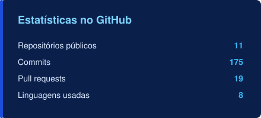
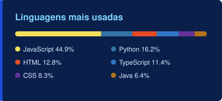

### Sobre mim

- Estudante de **Análise e Desenvolvimento de Sistemas** no Senac (conclusão em 2026)
- Assistente Administrativo na área de Engenharia de uma arena de eventos em São Paulo
- Uso **agentes de IA** (Claude Code), prompt engineering e vibe coding para transformar processos manuais em sistemas e automações
- Criei e mantenho uma central web que substituiu planilhas e macros da minha área, usada por ~20 pessoas
- Minhas automações economizam **até 14 horas por mês** da equipe (credenciamento 85% mais rápido, relatório pós-evento 67% mais rápido)

### Skills

### Projetos em destaque

| Projeto | O que resolve | Stack |
|---|---|---|
| **[Quiz ao vivo](https://github.com/limmuz/quiz-ao-vivo)** · [testar](https://limmuz.github.io/quiz-ao-vivo/) | Quiz estilo Kahoot para 100+ pessoas, com QR code, ranking e pódio | HTML · CSS · JS · WebRTC |
| **[Credenciamento automático](https://github.com/limmuz/credenciamento-automatico)** | Preenche sozinho o portal de credenciamento: de 30 para menos de 5 min por evento | Python · Selenium · Tkinter |
| **[Central de Engenharia](https://github.com/limmuz/central-eventos)** | Sistema interno de custos de eventos, NFs, budget e documentos; relatório pós-evento de 1h30 para 30 min | Python · Flask · SQLite · Chart.js |
| **[CONECTA](https://github.com/Conecta-PI/Front)** | CRM para microempreendedor (Projeto Integrador) | Figma · React Native |

**Veja tudo no portfólio: [limmuz.github.io](https://limmuz.github.io)**

### Estatísticas

 

### Contato

